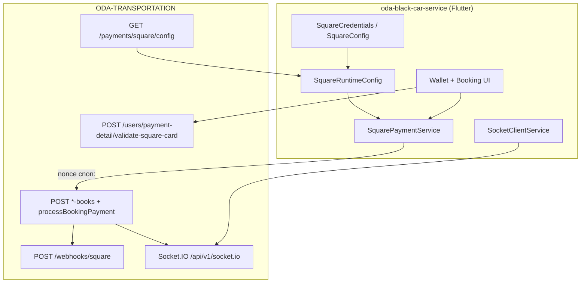

# Square Payment Integration — Handoff Summary (Flutter)

> **Purpose:** Use this document as the prompt/context when implementing and validating **iOS** for ODA Black Car Service.  
> **Status:** Square flows are implemented and tested on **Android (physical device)**. **iOS native setup and device testing are the main remaining work.**  
> **Reference web app:** `oda-ride-transport` (wallet save, checkout verify-before-consent, webhooks, Socket.IO realtime).

---

## 1. What we set out to do

Bring the Flutter mobile app (`oda-black-car-service`) to **parity with the ODA website** for Square payments:

| Flow | Website behavior | Mobile target |
|------|------------------|---------------|
| Wallet | Add card → Square tokenize → `POST /users/payment-detail/validate-square-card` | Same |
| Booking — saved card | Select primary / saved card → authorize on confirm | Same |
| Booking — new card | **Verify card before consent** (tokenize + hold nonce) → submit with `square.sourceId` | Same |
| Post-booking | Webhook updates payment → Socket.IO `payment.transaction.updated` | Same listener wired |

Backend: `ODA-TRANSPORTATION` (Node), production API `https://api.odatransportation.com/api/v1`.

---

## 2. Architecture (platform-agnostic — already done)



### Credential rules (do not break on iOS)

| Secret / key | Backend `.env` | Flutter app |
|--------------|----------------|-------------|
| `SQUARE_ACCESS_TOKEN` | Yes | **Never** |
| `SQUARE_APPLICATION_ID` | Yes | Fallback only; prefer runtime API |
| `SQUARE_LOCATION_ID` | Yes | Fallback only; prefer runtime API |
| `SQUARE_*_WEBHOOK_SIGNATURE_KEY` | Yes | **Never** |
| Webhook notification URL | Yes | **Never** (server-only) |

Runtime config is loaded at startup:

- `GET /payments/square/config` → `applicationId`, `locationId`, `environment`
- Provider: `SquareRuntimeConfig` in `main.dart`
- Fallback constants: `lib/core/config/square_credentials.dart`

### Dependencies added

- `square_in_app_payments: ^1.7.12` — Square In-App Payments SDK (iOS + Android)
- `socket_io_client: ^3.1.2` — booking payment realtime

---

## 3. Flutter implementation inventory (shared — iOS inherits this)

### Config layer

| File | Role |
|------|------|
| `lib/core/config/square_credentials.dart` | Single source for env (sandbox/production), application/location IDs, bundle IDs, dashboard checklist helpers |
| `lib/core/config/square_config.dart` | Thin wrapper over credentials |
| `lib/core/config/square_runtime_config.dart` | Fetches `GET /payments/square/config`, merges with fallbacks |
| `lib/config/app_config.dart` | `API_BASE_URL`, production defaults, Android emulator loopback helper |

### Services & models

| File | Role |
|------|------|
| `lib/data/services/square_payment_service.dart` | `InAppPayments.setSquareApplicationId` + `startCardEntryFlow` → nonce (`cnon:…`) |
| `lib/data/services/square_config_service.dart` | HTTP fetch for public Square config |
| `lib/data/services/payment_service.dart` | `saveSquareCard` → `POST /users/payment-detail/validate-square-card` |
| `lib/data/models/square_payment_payload.dart` | `{ sourceId }` for booking body |
| `lib/data/models/square_public_config.dart` | Parsed API config response |
| `lib/data/models/payment_method_type.dart` | `squareNewCard`, `squareSavedCard` |
| `lib/data/models/payment_detail_model.dart` | `squareCardId`, `squareCustomerId`, `last4`, `cardBrand`, etc. |
| `lib/data/models/*_booking_request.dart` | `square`, `squareCardId` on create payloads (airport, P2P, hourly) |

### Business logic

| File | Role |
|------|------|
| `lib/core/utils/booking_square_payment.dart` | Verify-before-submit validation, fee-stale check, `tokenizeSquareCheckoutCard` |
| `lib/core/utils/payment_card_utils.dart` | Saved card keys (`pd:` / `sq:`), dropdown labels, wallet display |
| `lib/core/utils/payment_status_map.dart` | Checkout hints by `paymentMode` (authorize vs capture) |
| `lib/providers/payment_provider.dart` | Wallet cards list, `validateAndSaveSquareCard` |
| `lib/providers/booking_provider.dart` | Socket room join from booking response, `payment.transaction.updated` handler |

### UI — Wallet

| File | Role |
|------|------|
| `lib/ui/screens/home/pages/wallet_page.dart` | Entry to add/manage cards |
| `lib/ui/screens/home/pages/square_wallet_add_sheet.dart` | Billing name + ZIP → Square SDK → validate-square-card (mirrors web `SquareWalletAddCard`) |

**Wallet crash fixes applied:** StatefulWidget lifecycle for controllers; hide form fields during SDK activity to avoid dispose-after-use.

### UI — Booking (all three forms)

| File | Role |
|------|------|
| `lib/ui/screens/home/pages/book_ride/widgets/square_payment_method_section.dart` | Primary / saved / new card picker + detail panel |
| `lib/ui/screens/home/pages/book_ride/widgets/square_checkout_new_card_panel.dart` | Step 1 billing + Step 2 verify (before consent) |
| `lib/ui/screens/home/pages/book_ride/widgets/square_payment_info_banner.dart` | Payment mode messaging |
| `lib/ui/screens/home/pages/book_ride/forms/point_to_point_form.dart` | Wired to Square section |
| `lib/ui/screens/home/pages/book_ride/forms/airport_booking_form.dart` | Wired to Square section |
| `lib/ui/screens/home/pages/book_ride/forms/hourly_charter_form.dart` | Wired to Square section |

**Booking UX rules implemented:**

1. New card: user must tap **Verify card** (Square SDK) **before** consent checkbox is enabled.
2. If estimated total changes after verify → force re-verify.
3. Saved cards: stable selection keys (`savedCardSelectionKey`) — no duplicate dropdown entries.
4. Default selection: primary card if present, else first saved, else new card.
5. Compact payment panel UI (wallet-style saved card row; tighter new-card spacing).

### Realtime (webhooks complement)

| File | Role |
|------|------|
| `lib/core/realtime/socket_client_service.dart` | Socket.IO to `{apiHost}/api/v1/socket.io`, event `payment.transaction.updated` |
| `lib/data/services/booking_realtime_token_service.dart` | Fetches room tokens for active bookings |

**Socket fix (native):** use `transports: ['websocket']` only on iOS/Android (`socket_io_client` does not implement HTTP polling on dart:io). Build origin URL without bogus `:0` port.

---

## 4. API contract (mobile ↔ backend)

### Public config

```
GET /api/v1/payments/square/config
→ { applicationId, locationId, environment, ... }
```

### Wallet save

```
POST /api/v1/users/payment-detail/validate-square-card
Body: { sourceId, cardOwnerName, billingZip, isPrimary? }
```

### Booking create (example)

```
POST /api/v1/point-to-point-books  (also airport-books, hourly-charter-books)
Body includes:
  paymentMethod: "SQUARE_NEW_CARD" | "SQUARE_SAVED_CARD"
  square: { sourceId }           // new card (after verify)
  squareCardId: "ccof:..."       // saved card
```

### Realtime

- Booking create response may include `realtime: { provider: "socket.io", event: "payment.transaction.updated", roomToken }`
- Client emits `join` with `{ token: roomToken }`
- Server pushes `payment.transaction.updated` when Square webhook settles payment

### Webhooks (server only)

- Square → `POST /api/v1/webhooks/square`
- Verified with `SQUARE_PRODUCTION_WEBHOOK_SIGNATURE_KEY` in backend `.env`
- **Not used in the mobile app**

---

## 5. Production configuration

### Backend (`ODA-TRANSPORTATION/.env`) — production block configured

- `SQUARE_ENV=production`
- `SQUARE_APPLICATION_ID=sq0idp-KGHJzmdtUHXPJAPWR0cbjA`
- `SQUARE_LOCATION_ID=45AM047H464XK`
- `SQUARE_PRODUCTION_WEBHOOK_SIGNATURE_KEY` set
- `SQUARE_PRODUCTION_WEBHOOK_NOTIFICATION_URL=https://api.odatransportation.com/api/v1/webhooks/square`
- `PAYMENT_PROVIDER=square`, `PAYMENT_MODE=authorize_capture`

### Flutter production build

```bash
flutter build ipa --release \
  --dart-define=API_BASE_URL=https://api.odatransportation.com/api/v1 \
  --dart-define=SQUARE_ENV=production
```

Release builds also default API to production when `API_BASE_URL` is omitted (`kReleaseMode`).

See also: `docs/production-build.md`.

---

## 6. What was done specifically for Android

These items are **done and verified on a physical Android device**. iOS should mirror the **Flutter/Dart** behavior; only **native/platform** steps differ.

| Area | Android work completed |
|------|------------------------|
| **Package name** | `com.odatransportation.app` in `android/app/build.gradle` (`applicationId` + `namespace`) |
| **Square Dashboard** | Mobile Payments SDK → **Android** signature: package name + **SHA-256** from `./gradlew signingReport` (release keystore for production) |
| **minSdk** | `28` (Square SDK requirement) |
| **targetSdk / compileSdk** | `35` |
| **16 KB page size** | NDK r28, ABI filters, packaging flags for Play Store compliance |
| **Signing** | Release via `key.properties` + ProGuard |
| **Device testing** | Physical device against production API; Square card entry, wallet save, booking verify flow |
| **Crashes fixed** | TextEditingController dispose during Square sheet; build-phase setState from payment widgets; RenderFlex overflow on wallet |
| **Socket** | Websocket-only transport on native; origin URL fix |
| **Emulator helper** | `USE_ANDROID_EMULATOR_LOOPBACK` dart-define maps prod host → `10.0.2.2` |

### Android build command (Play Store)

```bash
flutter build appbundle --release \
  --dart-define=API_BASE_URL=https://api.odatransportation.com/api/v1 \
  --dart-define=SQUARE_ENV=production
```

---

## 7. iOS — what exists vs what you still need to do

### Already in repo (no Square-specific native code yet)

| Item | Current state |
|------|---------------|
| **Bundle ID** | `com.odatransportation.app` in `ios/Runner.xcodeproj/project.pbxproj` |
| **Deployment target** | iOS 13.0 |
| **AppDelegate** | Google Maps init only — no extra Square setup (plugin handles SDK via CocoaPods) |
| **Dart/Flutter** | Full Square UI + services — **shared with Android** |
| **square_credentials.dart** | Documents `iosBundleId`, `iosTeamId` dart-defines |

### ⚠️ Known mismatch to resolve

Square Developer Dashboard may still list an **old** iOS bundle ID (e.g. `com.odablackcarservice.app`).  
**Xcode project uses `com.odatransportation.app`.**  
Production iOS builds **must** register the **exact** bundle ID + Apple Team ID in Square → Mobile Payments SDK → iOS signature.

### iOS checklist (use as implementation prompt)

1. **Align identifiers**
   - Confirm `PRODUCT_BUNDLE_IDENTIFIER` = `com.odatransportation.app` (or update Square dashboard + credentials to match if product decision differs).
   - Set Apple **Team ID** in Square dashboard (documented in `SquareCredentials.iosTeamId` / `--dart-define=SQUARE_IOS_TEAM_ID=...` for reference only — not passed to SDK).

2. **CocoaPods / Xcode**
   - `cd ios && pod install`
   - Open `Runner.xcworkspace` (not `.xcodeproj`)
   - Ensure `square_in_app_payments` pod resolves; fix any deployment-target warnings (Square may need iOS 12+; project is 13.0).

3. **Square Dashboard — production**
   - Mobile Payments SDK → Add **iOS** application signature: **Bundle ID** + **Team ID**
   - Same production Application ID / Location ID as Android (`sq0idp-…`, `45AM047H464XK`)

4. **Build & run on physical iPhone** (Square SDK does not support simulator card entry for real charges)
   ```bash
   flutter run --release \
     --dart-define=API_BASE_URL=https://api.odatransportation.com/api/v1 \
     --dart-define=SQUARE_ENV=production
   ```

5. **Test matrix (parity with Android)**
   - [ ] App launch → `GET /payments/square/config` succeeds
   - [ ] Wallet → Add card → billing → Square sheet → card saved in list
   - [ ] Booking → Primary saved card → consent → submit → authorize
   - [ ] Booking → New card → verify **before** consent → submit with nonce
   - [ ] Total change after verify → forces re-verify
   - [ ] Socket connects (websocket) and receives `payment.transaction.updated` after webhook
   - [ ] Saved card dropdown: unique keys, primary excluded from alternate list

6. **App Store**
   - `flutter build ipa` with same dart-defines as production
   - TestFlight build uses same bundle ID registered in Square

7. **Do NOT add to iOS app**
   - Access token, webhook signature key, or any server secret

---

## 8. Bugs fixed during integration (apply same expectations on iOS)

| Issue | Resolution |
|-------|------------|
| Verify on final “Book” tap only | Moved verify to payment section; consent disabled until verified |
| `TextEditingController` used after dispose | Wallet sheet → StatefulWidget; hide fields during SDK |
| `_dependents.isEmpty` / dirty build | Removed parent `setState` from nested payment widgets |
| Saved card dropdown duplicates | `savedCardSelectionKey`, `findSavedSquareCard`, exclude primary from dropdown |
| Wallet list overflow | `Expanded` + ellipsis; `formatSquareWalletCardNumber()` |
| Socket `connect_error` with `:0` / polling on native | Websocket-only on dart:io; explicit socket origin from `Uri` |
| Oversized payment panels | Compact saved-card panel; reduced new-card min-heights |

---

## 9. File map (quick navigation)

```
lib/
├── config/app_config.dart
├── core/
│   ├── config/square_credentials.dart      ← env + dashboard checklist
│   ├── config/square_config.dart
│   ├── config/square_runtime_config.dart
│   ├── realtime/socket_client_service.dart
│   └── utils/booking_square_payment.dart
├── data/
│   ├── models/square_*.dart
│   └── services/square_*.dart, payment_service.dart
├── providers/payment_provider.dart, booking_provider.dart
└── ui/screens/home/pages/
    ├── square_wallet_add_sheet.dart
    ├── wallet_page.dart
    └── book_ride/widgets/square_*.dart
```

---

## 10. Suggested iOS agent prompt (copy-paste)

```
You are implementing iOS validation for ODA Black Car Service Square payments.

Context: Flutter app oda-black-car-service already has full Square integration in Dart
(wallet save, booking verify-before-consent, saved cards, Socket.IO). Android physical
device testing is complete. Your job is iOS-native setup + physical device E2E only.

Read: docs/square-payment-handoff-for-ios.md

Constraints:
- Do not add SQUARE_ACCESS_TOKEN or webhook keys to the app.
- Use runtime GET /payments/square/config + square_credentials.dart fallbacks.
- Bundle ID must match Square Mobile Payments SDK iOS signature.
- Test on real iPhone with --dart-define=SQUARE_ENV=production and production API URL.
- Reuse existing Dart UI/services; only change iOS project/Pods/Info.plist if square_in_app_payments requires it.

Verify: wallet add card, booking new card verify flow, booking saved card, socket payment updates.
```

---

## 11. Related docs in repo

- `docs/production-build.md` — release dart-defines and server checklist
- `ios/ios_deployment_fix.md` — general iOS deployment notes (device install)

---

*Last updated: handoff for iOS work after Android Square integration, wallet/booking UI polish, and Socket.IO native transport fix.*
